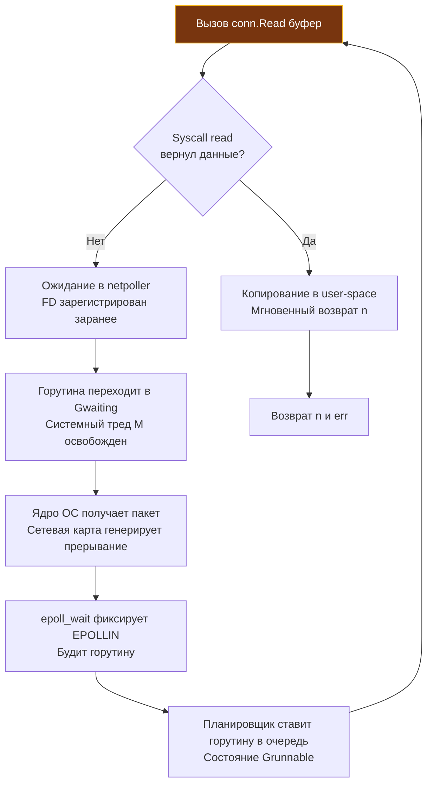

## Фундамент сетевого стека и неблокирующий ввод-вывод

В классическом программировании на C сетевой ввод-вывод всегда был разделен на два одинаково неудобных лагеря: либо блокирующие сокеты, требующие выделения отдельного тяжелого потока ОС на каждого клиента, либо неблокирующий мультиплексированный ввод-вывод (`select`, `poll`, `epoll`), низвергающий разработчика в пучину конечных автоматов, буферов фрагментов и сложнейших асинхронных колбэков.

Пакет `net` в Go совершил тихую инженерную революцию. Это не просто тонкая обертка над POSIX-сокетами. Это глубоко интегрированная в рантайм Go подсистема, реализующая высокоуровневую асинхронную модель программирования без колбэков, промисов или event-loop'ов, видимых разработчику. Благодаря ему, сетевой код на Go выглядит синхронным, прямолинейным и чистым, но под капотом исполняется предельно асинхронно на уровне планировщика горутин и ядра операционной системы.

Для инженера уровня Senior понимание `net` — это понимание того, как десятки и сотни тысяч соединений обслуживаются одним бинарником с минимальным потреблением памяти и CPU, как работает интеграция с `epoll`/`kqueue`, и почему сетевые таймауты в Go фундаментально отличаются от таймаутов на уровне `context`.

> [!info] Под капотом
> В основе пакета лежат интерфейсы `net.Conn` и `net.Listener`. Они абстрагируют потоковый и дейтаграммный IO, предоставляя унифицированный API для TCP, UDP, Unix-сокетов и IP-протоколов. Реальные реализации (например, `*net.TCPConn`) делегируют работу структуре `netFD`, которая связывает файловый дескриптор сокета с внутренним сетевым поллером (`netpoller`).

## Under the hood: netpoller, G-M-P и асинхронность без колбэков

Классический блокирующий socket API (`read`, `write`, `accept`) останавливает выполнение потока ОС до готовности данных или завершения записи. В Go сокеты создаются в неблокирующем режиме (`O_NONBLOCK` на Linux, `ioctlsocket` на Windows). 

Механика работы при вызове `conn.Read()`:
1. Вызывается syscall `read()`. Если данные есть в сетевом буфере ядра, они копируются в буфер приложения мгновенно.
2. Если данных нет, `read()` возвращает ошибку `EAGAIN`/`EWOULDBLOCK`.
3. Рантайм Go не блокирует системный тред. Дескриптор сокета уже зарегистрирован в **сетевом поллере** (`epoll` на Linux, `kqueue` на macOS/BSD, `IOCP` на Windows) при создании соединения (edge-triggered); рантайм лишь паркует горутину до события готовности.
4. Горутина переводится в состояние `Gwaiting` и паркуется с помощью вызова `gopark`. Системный тред `M` освобождается для выполнения других горутин из локальной очереди `P`.
5. Поллер опрашивают сам планировщик (простаивающий поток ждёт в `epoll_wait`) и `sysmon`; когда в ядре ОС появляется событие `EPOLLIN`, горутина переходит в состояние `Grunnable`.



Эта архитектура позволяет обрабатывать сотни тысяч одновременных соединений, используя лишь десятки системных тредов. Планировщик Go и `netpoller` работают как единый механизм, скрывая сложность асинхронности за синхронным API.

## 1. Интерфейсы Conn и Listener: контракты и дедлайны

### net.Conn

Интерфейс `net.Conn` объединяет поток ввода-вывода с управлением сетевым адресом и таймаутами:

```go
type Conn interface {
    Read(b []byte) (n int, err error)
    Write(b []byte) (n int, err error)
    Close() error
    LocalAddr() Addr
    RemoteAddr() Addr
    SetDeadline(t time.Time) error
    SetReadDeadline(t time.Time) error
    SetWriteDeadline(t time.Time) error
}
```

**Ключевая особенность:** `net.Conn` **потокобезопасен** для дуплексного режима. Вы можете безопасно вызывать `Read` в одной горутине и `Write` в другой горутине одновременно для одного и того же сокета (в отличие от `bufio`, который требует внешней синхронизации). Один вызов `Write` пишет свои байты целиком, но если сообщение протокола собирается из нескольких `Write`, сообщения разных горутин перемешаются. Сериализуйте запись мьютексом или отдельной горутиной-писателем.

### net.Listener

```go
type Listener interface {
    Accept() (Conn, error)
    Close() error
    Addr() Addr
}
```

Вызов `Accept()` блокируется на уровне планировщика до появления нового входящего соединения. При вызове `Close()` все ожидающие `Accept` горутины немедленно просыпаются с ошибкой `net.ErrClosed`.

> [!warning] Ловушка / Gotcha
> **Дедлайны vs Context.**
> `conn.SetDeadline()` работает на уровне `netpoller` и системных таймеров. Он принимает абсолютный момент времени (`time.Time`), а не относительную длительность (`time.Duration`), и является «липким» (sticky): если дедлайн наступил, все последующие операции ввода-вывода будут мгновенно возвращать ошибку таймаута, пока дедлайн явно не сбросят вызовом `conn.SetDeadline(time.Time{})`.
> В свою очередь, `context.Context` управляет логическим временем жизни операции в бизнес-слое. В `net/http` связь обратная: когда сервер замечает, что клиент закрыл соединение, он отменяет `r.Context()`. Чтобы обработчик прервал работу, передавайте этот контекст в свои вызовы (БД, исходящие HTTP-запросы). Не смешивайте их без четкого понимания границ ответственности.

## 2. Mechanical Sympathy: Файловые дескрипторы, epoll и цена syscall

### Файловые дескрипторы и лимиты ОС

Каждый `net.Conn` потребляет 1 файловый дескриптор (FD). В Linux лимит — `RLIMIT_NOFILE` (его показывает команда оболочки `ulimit -n`; мягкий лимит по умолчанию часто 1024, но Go с 1.19 при старте сам поднимает его до жёсткого). Поэтому для Go-сервиса важен жёсткий лимит: настройте `LimitNOFILE` в systemd (или `--ulimit nofile` в Docker) до `65535` или выше, при необходимости — `fs.file-max`. Утечка FD из-за забытого `conn.Close()` — одна из самых частых причин падения сервисов.

### Буферы ядра и Nagle's Algorithm

Сокеты имеют буферы на уровне ядра (`SO_SNDBUF`, `SO_RCVBUF`). В Go для всех TCP-соединений флаг `TCP_NODELAY` **включен по умолчанию** (`setNoDelay(fd, true)` при инициализации сокета), то есть алгоритм Нагла отключен. Это сделано намеренно для минимизации задержек (latency) в RPC и веб-сервисах. Если вам требуется включить алгоритм Нагла для коалесценции мелких пакетов при массивной потоковой передаче, это делается явно:

```go
tcpConn, ok := conn.(*net.TCPConn)
if ok {
    tcpConn.SetNoDelay(false) // Включение алгоритма Нагла при необходимости
}
```

По умолчанию Go ориентирован на минимальную сетевую задержку, отправляя данные сразу после вызова `Write`.

### Цена создания сокета

`net.Dial` выполняет:
1. `socket()` — создание FD (syscall)
2. `setsockopt()` — настройка неблокирующего режима, буферов, таймаутов (syscall)
3. `connect()` — TCP handshake (syscall)

При высокой нагрузке (десятки подключений в секунду к внешним API) это создает заметный overhead. Используйте пулы соединений (`http.Transport`, `pgxpool`), чтобы переиспользовать установленные сокеты.

## 3. Идиоматичные паттерны: Accept loop и конкурентные записи

### Правильный Accept loop

Никогда не используйте `Accept` в цикле без обработки ошибок и контекста. Это приводит к busy-loop при закрытии листенера или утечке горутин.

```go
func runServer(ln net.Listener) error {
    var delay time.Duration
    for {
        conn, err := ln.Accept()
        if err != nil {
            if errors.Is(err, net.ErrClosed) {
                return nil // листенер закрыт — штатный выход
            }
            // Временная ошибка (например, EMFILE): подождать и продолжить
            delay = min(max(2*delay, 5*time.Millisecond), time.Second)
            log.Printf("accept error: %v; retrying in %v", err, delay)
            time.Sleep(delay)
            continue
        }
        delay = 0
        
        // Обработка в отдельной горутине
        go handleConnection(conn)
    }
}

func handleConnection(conn net.Conn) {
    defer conn.Close() // Гарантирует освобождение FD и ресурсов ядра
    
    buf := make([]byte, 4096)
    for {
        // Дедлайн продлеваем перед каждым Read: это таймаут простоя, а не на всё соединение
        conn.SetReadDeadline(time.Now().Add(30 * time.Second))
        n, err := conn.Read(buf)
        process(buf[:n]) // сначала n, потом err: данные могли прийти вместе с ошибкой
        if err != nil {
            if netErr, ok := err.(net.Error); ok && netErr.Timeout() {
                log.Println("Read timeout")
                return
            }
            if err == io.EOF {
                return
            }
            log.Printf("Read error: %v", err)
            return
        }
    }
}
```

## 4. Разрешение имен и асинхронный DNS

Функции `net.LookupIP`, `net.Dial` используют `net.DefaultResolver`. Резолвер через `cgo` (`getaddrinfo`) занимает системный тред на время запроса.

С Go 1.5 на большинстве Unix-систем по умолчанию используется резолвер на чистом Go: каждый запрос занимает горутину, а не поток. Он читает `/etc/resolv.conf`, отправляет UDP-запросы напрямую через сокет и парсит ответ без блокировки OS-тредов. Рантайм переключается на системный `getaddrinfo` (cgo), если этого требует конфигурация (`/etc/nsswitch.conf`, особые опции `resolv.conf`); на macOS и Windows по умолчанию используется системный резолвер. Принудительно — `GODEBUG=netdns=go` или `netdns=cgo`.

```go
// Настройка кастомного резолвера с таймаутом
resolver := &net.Resolver{
    PreferGo: true,
    Dial: func(ctx context.Context, network, address string) (net.Conn, error) {
        d := net.Dialer{Timeout: 2 * time.Second}
        return d.DialContext(ctx, network, address)
    },
}
ips, err := resolver.LookupIPAddr(context.Background(), "api.example.com")
```

> [!info] Под капотом
> Стандартный пакет `net` принципиально **не кэширует** DNS-ответы внутри рантайма Go. Кэширование возлагается на системные службы ОС (`systemd-resolved`, `nscd`, `dnsmasq`) или сетевую инфраструктуру. Выбор между нативным чистым Go-резолвером и системным libc/cgo управляется через `GODEBUG=netdns=go` или `netdns=cgo` (а флаг `netdns=1` включает подробный отладочный вывод).

## Ловушки и хардкорные вопросы с собеседований

| Сценарий | Проблема | Решение |
|----------|----------|---------|
| `conn.Write` конкурентно | Хотя `net.Conn` потокобезопасен, фреймы протокола могут перемешиваться | Используйте `sync.Mutex` или один `Writer` на соединение, если протокол не мультиплексирует. |
| `Accept` без разбора ошибок | Закрытие `Listener` возвращает `ErrClosed`, цикл уходит в busy-loop; а `return` на временной ошибке (`EMFILE`) навсегда остановит приём соединений | Штатный выход — по `errors.Is(err, net.ErrClosed)`; на временных ошибках ждите с нарастающей паузой и продолжайте (как делает `http.Server`). |
| Игнорирование `SetDeadline` | Зомби-соединения висят годами, занимая FD и память | Устанавливайте Read/Write дедлайны. Для keep-alive используйте heartbeat. |
| `net.Dial` в цикле без пула | Каждый запрос = TCP handshake + TLS + аллокации | Используйте `http.Transport` или `net.Dialer` с `KeepAlive` и пулами соединений. |
| `SO_REUSEADDR` и `SO_REUSEPORT` | `SO_REUSEPORT` позволяет нескольким процессам слушать один порт (RPS scaling) | В Go `net.Listen` включает `SO_REUSEADDR` автоматически. Для `SO_REUSEPORT` опцию нужно задать в `net.ListenConfig.Control`, который вызывается до `bind` (опция, выставленная потом на готовом fd, уже не учтётся). |

```go
lc := net.ListenConfig{Control: func(network, address string, c syscall.RawConn) error {
    var serr error
    err := c.Control(func(fd uintptr) {
        serr = unix.SetsockoptInt(int(fd), unix.SOL_SOCKET, unix.SO_REUSEPORT, 1)
    })
    return errors.Join(err, serr)
}}
ln, err := lc.Listen(ctx, "tcp", ":8080")
```

> [!tip] Собеседование
> **Вопрос:** Почему `net.Conn.Read` может вернуть `n > 0` и `err != nil` одновременно?
> **Ответ:** Это штатное поведение для сетевых стеков. Например, при получении `EOF` после чтения последних байтов, `Read` вернет прочитанные данные и `io.EOF`. Или при таймауте с частично прочитанными данными. **Всегда обрабатывайте `n` перед проверкой `err`.**
>
> **Вопрос:** Как Graceful Shutdown работает с `net.Listener`?
> **Ответ:** При вызове `ln.Close()` блокирующий `Accept()` просыпается с `net.ErrClosed`. HTTP-сервер Go использует это для остановки приема новых соединений, а затем ждет завершения активных запросов через `context` и таймауты.

## Сравнение с экосистемами других языков

| Язык | Механизм | Особенности в сравнении с Go |
|------|----------|------------------------------|
| **Java** | NIO.2, `Selector`, `EventLoop` | Явное управление `ByteBuffer`, регистрация каналов, ручная обработка колбэков. Высокий boilerplate, но полный контроль. |
| **Python** | `asyncio` + `selectors` | Event-loop в user-space, `await/async`. GIL блокирует CPU-нагрузку. Go встраивает асинхронность в рантайм и планировщик. |
| **C++** | Boost.Asio, `epoll`/`io_uring` | Zero-overhead, колбэки или coroutines. Максимальная скорость, но сложность управления жизненным циклом и памятью. |
| **PHP** | `stream_socket_client` | Блокирующий по умолчанию. Async реализуется через расширения (`swoole`) или внешние очереди. Не предназначен для высоконагруженных демонов. |
| **Go** | `net` + `netpoller` + G-M-P | Синхронный API, асинхронное исполнение. Автоматическое управление горутинами, таймерами и поллером. Баланс скорости и простоты. |

## Итог

1. `net` предоставляет синхронный API поверх асинхронного `netpoller`, интегрированного с планировщиком G-M-P. Это устраняет callback hell и event-loop boilerplate.
2. `net.Conn` потокобезопасен, но требует явного `Close()` и управления дедлайнами для предотвращения утечек FD и зомби-соединений.
3. DNS-резолвер в Go асинхронный и не блокирует системные треды, что критично для микросервисов.
4. Всегда настраивайте `SetDeadline`, обрабатывайте `net.Error.Timeout()` в циклах и используйте пулы соединений для внешних вызовов.
5. Для low-latency систем отключайте Nagle's algorithm (`SetNoDelay(true)`). Для масштабируемых серверов используйте `SO_REUSEPORT`.

Понимание низкоуровневой работы с сетью логически подводит нас к работе с адресацией и параметрами запросов. Как корректно парсить, валидировать и экранировать URL-ы, избегая инъекций и ошибок маршрутизации? В следующей статье: [[32. net_url. URL, query parameters и escaping]].