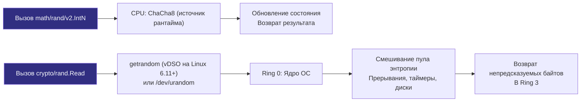

## Философия разделения: Скорость против Безопасности

В вычислительной технике понятие «случайности» обманчиво. Компьютер — детерминированная машина, и заставить процессор выдать число, не вытекающее из предыдущего состояния регистров, — фундаментальная инженерная дилемма. В Go генерация случайных чисел строго разделена на два пакета, отражающих ключевой компромисс системного программирования: **производительность** против **непредсказуемости**.

Пакет `math/rand` реализует быстрый алгоритмический генератор псевдослучайных чисел (PRNG). Он детерминирован, вычисляется исключительно на CPU и предназначен для симуляций, игр, случайной выборки данных и небезопасных идентификаторов. Начиная с Go 1.20, он автоматически инициализируется случайным seed-ом при старте программы, что упрощает работу, но не меняет его криптографическую слабость. В современном Go (Go 1.22+) появился пакет нового поколения `math/rand/v2`, использующий быстрые алгоритмы PCG и ChaCha8 с поддержкой дженериков `rand.N[T](n)`.

Пакет `crypto/rand` — это интерфейс к генератору криптографически стойких случайных чисел (CSPRNG). Он опирается на пул энтропии ядра ОС, гарантируя, что следующий байт невозможно предсказать даже при знании всех предыдущих. Это единственный допустимый источник для токенов сессий, паролей, nonce, ключей шифрования и любых данных, где утечка паттернов ведет к взлому системы.

> [!info] Под капотом
> Разделение пакетов — это архитектурный контракт безопасности. Компилятор и линтеры не могут запретить использование `math/rand` для токенов, но это считается критической уязвимостью уровня CWE-330. Инженер обязан явно выбирать источник, исходя из модели угроз, а не из удобства импорта.

## Under the hood. Алгоритмы и источники энтропии

### Механика math/rand

Пакет `math/rand` (v1) исторически использует аддитивный алгоритм Lagged Fibonacci. В Go 1.20 в нем добавили лишь автосидирование глобального генератора при старте. В `math/rand/v2` (Go 1.22+) глобальные функции используют **ChaCha8** со случайным seed. Для воспроизводимых последовательностей есть источники `rand.NewPCG(seed1, seed2)` (**PCG**, Permuted Congruential Generator, 128-битное состояние) и `rand.NewChaCha8(seed)`. Для ключей и токенов всё равно используйте `crypto/rand`.

С Go 1.20 глобальные функции `math/rand` (если `Seed` не вызывался) и всегда — функции `math/rand/v2` используют генератор рантайма с состоянием на каждый поток, без мьютекса. Отдельный `rand.Rand` из `rand.New(rand.NewSource(seed))` нужен для воспроизводимой последовательности с фиксированным seed, но **запрещает** конкурентный доступ к одному экземпляру.

### Механика crypto/rand

Пакет не реализует математику сам. Он выступает тонкой оберткой над системными вызовами:
* **Linux**: `getrandom()` (современные ядра) или чтение `/dev/urandom`.
* **macOS/FreeBSD**: `getentropy()` или `sysctl(KERN_URND)`.
* **Windows**: `BCryptGenRandom()`.

На современных системах пул энтропии ядра не «истощается». Он смешивает шумы аппаратных прерываний, таймеров, дисков и сетевого стека. Вызов `crypto/rand` обращается к ядру: на Linux 6.11+ (Go 1.24+) `getrandom` вызывается через vDSO, без перехода в ядро на каждый вызов, на старых ядрах — системным вызовом. Это гарантирует криптографическую стойкость, но добавляет задержку.



## Mechanical Sympathy: CPU-циклы, contention и аллокации

### 1. Цена конкуренции в math/rand

В Go 1.20+ глобальные функции не создают точку конкуренции; пул локальных генераторов не нужен и медленнее (замер: глобальный `rand.Intn` — ~7 нс, пул из статьи — 12–16 нс). Свой `rand.Rand` нужен для воспроизводимой последовательности с фиксированным seed. Для этого сценария пул источников выглядит так (учтите, что seed `time.Now().UnixNano()` совпадает у одновременно созданных генераторов):

```go
var randPool = sync.Pool{
    New: func() interface{} {
        // Go 1.20+ автоматически сидирует, но для детерминизма можно указать явно
        return rand.New(rand.NewSource(time.Now().UnixNano()))
    },
}

func fastRandomInt(n int) int {
    r := randPool.Get().(*rand.Rand)
    defer randPool.Put(r)
    return r.Intn(n)
}
```

Это устраняет блокировки, так как каждая горутина работает с изолированным состоянием генератора, но для обычной работы выигрыша не даёт.

### 2. Syscall overhead в crypto/rand

На старых ядрах каждый `rand.Read` — системный вызов (сотни наносекунд); с vDSO — десятки наносекунд (замер: 16 байт — около 41 нс против ~7 нс у глобального `math/rand.Intn`). Для генерации больших объемов данных (например, ключей или токенов) предпочтительно запрашивать буфер нужного размера одним вызовом, а не вызывать `Read([]byte{b})` в цикле.

### 3. GC и аллокации

`math/rand` не аллоцирует память после инициализации. `crypto/rand` также минимален, но передача среза `[]byte` в `rand.Read()` может вызвать escape analysis, если буфер создается внутри цикла. Всегда переиспользуйте буферы или создавайте их вне горячих путей.

## Идиомы и паттерны для Production

### Безопасная генерация токенов

Никогда не конвертируйте случайные байты в строку через `fmt.Sprintf` или `string()`. Используйте кодирование `base64.RawURLEncoding` (без `=`) для URL-безопасных идентификаторов. С Go 1.24 проще: `rand.Text()` возвращает криптостойкую строку (26 символов base32, 128 бит):

```go
func GenerateSecureToken(length int) (string, error) {
    b := make([]byte, length)
    if _, err := rand.Read(b); err != nil {
        return "", fmt.Errorf("read crypto rand: %w", err)
    }
    // URL-safe, без `=`, предсказуемая длина
    return base64.RawURLEncoding.EncodeToString(b), nil
}
```

### Перемешивание слайсов

`rand.Shuffle` использует глобальный источник. Для больших слайсов в конкурентной среде лучше реализовать собственный алгоритм Фишера-Йетса с локальным `rand.Rand`, если нужна воспроизводимая последовательность.

## Ловушки и вопросы с собеседований

| Сценарий | Проблема | Решение |
|----------|----------|---------|
| `math/rand` для JWT токенов | Алгоритм детерминирован. Зная seed, атакер восстановит все прошлые и будущие токены. | Используйте строго `crypto/rand`. |
| Общий `rand.Rand` между горутинами | Гонка данных: состояние генератора портится, `go test -race` это покажет. | Свой генератор на горутину или глобальные функции (они потокобезопасны). |
| `/dev/random` блокирует процесс | На старых ядрах Linux `/dev/random` блокируется при низкой энтропии. | Go использует `getrandom` (или `/dev/urandom`). После инициализации пула ядра они не блокируются; ждать можно только в первые секунды загрузки системы. |
| `crypto/rand.Read` возвращает `n < len` | В отличие от `io.Reader`, `rand.Read` всегда заполняет буфер полностью или возвращает ошибку. | Не нужно проверять `n` в цикле. Достаточно `if _, err := rand.Read(b); err != nil`. С Go 1.24 `rand.Read` всегда возвращает `nil`. |
| Auto-seed в Go 1.20+ | Разработчик вручную сидирует `math/rand`, ломая авто-инициализацию или делая её предсказуемой. | Не вызывайте `rand.Seed()` в новых версиях: с `go 1.24`+ в `go.mod` он ничего не делает. Для воспроизводимости используйте `rand.New(rand.NewSource(seed))`. Удаляйте legacy-код. |

> [!tip] Собеседование
> **Вопрос:** Почему `math/rand` не является потокобезопасным для локальных экземпляров, в отличие от глобальных функций?
> **Ответ:** Глобальные функции безопасны для конкурентного вызова (с Go 1.20 они используют генератор рантайма без мьютекса). Локальный `rand.Rand` спроектирован для максимальной производительности в однопоточных контекстах (например, симуляции, однопоточные алгоритмы). Добавление синхронизации в каждый вызов локального источника нарушило бы принцип zero-overhead абстракций Go и ухудшило бы производительность даже там, где синхронизация не нужна.
>
> **Вопрос:** Как проверить, что генератор криптографически стойкий, не читая документацию?
> **Ответ:** Проверьте пакет импорта. Только `crypto/rand` гарантирует CSPRNG. Любые математические преобразования над `math/rand` (хеширование, соль, умножение) не повышают энтропию, а лишь маскируют предсказуемость. Криптографическая стойкость обеспечивается исключительно источником, а не обработкой вывода.

## Сравнение с экосистемами других языков

| Язык | Пакет / Механизм | Особенности в сравнении с Go |
|------|------------------|------------------------------|
| **Python** | `random` vs `secrets` / `os.urandom` | `random` использует Mersenne Twister. `secrets` обертка над `os.urandom`. Разделение есть, но `random` по умолчанию не потокобезопасен. Go `math/rand` безопаснее глобально, но требует явного пулинга для скорости. |
| **Java** | `java.util.Random` vs `SecureRandom` | `Random` использует линейный конгруэнтный генератор. `SecureRandom` делегирует ОС. В Java `SecureRandom` может блокироваться на старых системах, в Go этого не происходит благодаря `getrandom`. |
| **C++** | `std::rand()` vs `std::random_device` | `std::rand()` считается устаревшим и плохим. `random_device` часто реализован через `/dev/urandom`, но стандарт не гарантирует криптографическую стойкость. Go дает строгие гарантии API. |
| **Go** | `math/rand` vs `crypto/rand` | Четкое разделение, авто-сидирование в 1.20+, потокобезопасные глобальные вызовы, гарантия неблокируемости CSPRNG на всех ОС. |

## Итог

1. `math/rand` — для скорости, симуляций и некритичных данных. Начиная с Go 1.20, автоматически сидируется. Глобальные функции потокобезопасны, локальные — нет.
2. `crypto/rand` — строго для секретов, токенов и криптографии. Использует syscall к энтропии ядра, не блокируется, потокобезопасен.
3. Глобальные функции `math/rand` с Go 1.20 не создают точку конкуренции: пул локальных источников нужен только для воспроизводимой последовательности с фиксированным seed.
4. Никогда не пытайтесь «улучшить» `math/rand` хешированием или солью для безопасности. Детерминизм алгоритма делает предсказуемость неизбежной при известном seed.
5. `crypto/rand.Read` всегда заполняет буфер целиком или возвращает ошибку. Не проверяйте `n` в цикле.

Разобравшись с источниками случайности, мы переходим к фундаментальным инструментам защиты данных. Как Go реализует криптографические примитивы, обеспечивает безопасность на уровне CPU и почему стандартная библиотека отказалась от устаревших алгоритмов? В следующей статье: [[38. crypto. Хеши, HMAC, AES, RSA, TLS]].