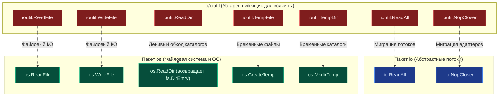
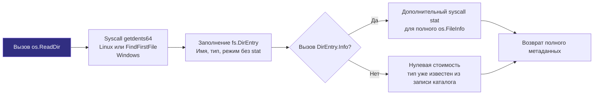

## Исторический контекст и декатализация

> *«Правило простоты: проектируйте простоту изначально; добавляйте сложность только тогда, когда без неё не обойтись».*    
> — Философия Unix

В каждом доме есть ящик письменного стола, куда складывают всё, чему не нашлось очевидного места: изоленту, запасные батарейки, переходники и связки старых ключей. В ранней экосистеме Go (начиная с версии 1.0) таким «ящиком для всякой всячины» стал вспомогательный пакет `io/ioutil`. Если разработчику нужно было быстро прочитать файл целиком, отбросить закрытие потока или создать временную директорию, рука сама тянулась к спасительному `ioutil`.

Однако по мере взросления языка и архитектуры стандартной библиотеки этот ящик стал причиной архитектурного дискомфорта. Начиная с версии Go 1.16, пакет `io/ioutil` официально переведён в статус `deprecated`. Это не было случайным рефакторингом или капризом разработчиков. Команда Go провела масштабный аудит стандартной библиотеки и обнаружила, что `ioutil` нарушает ключевые принципы проектирования Go: логическую группировку по доменам, строгую ортогональность и минимализм.

Функции из `ioutil` были хаотично разбросаны между операциями с абстрактными потоками данных (`io`) и операциями с файловой системой операционной системы (`os`). Их миграция в соответствующие пакеты устранила эту архитектурную асимметрию, структурировала API и подготовила почву для внедрения унифицированной файловой абстракции `io/fs`.



> [!info] Под капотом
> Пакет `io/ioutil` **не удалён** из компилятора ради обещания обратной совместимости Go 1 Compatibility Promise. Вы можете продолжать его импортировать в легаси-кодовой базе, код скомпилируется и будет безупречно работать. Внутренне в `src/io/ioutil/ioutil.go` функции превращены в тривиальные прокси-обертки (type aliases и forward-вызовы `io.ReadAll`, `os.ReadFile` и т.д.). Однако `staticcheck` (SA1019) и `gopls` помечают его функции как устаревшие. В новых проектах и при рефакторинге легаси миграция обязательна.

---

## 1. Почему пакет `io/ioutil` исчез из рекомендаций

Основная причина — грубое нарушение границы ответственности (Separation of Concerns). `ioutil` содержал функции, которые по своей природе относятся к принципиально разным слоям абстракции компьютерной системы:

* **Потоковые операции (`ReadAll`, `NopCloser`)** логичнее живут в пакете `io`, так как работают с абстрактными интерфейсами `io.Reader` и `io.Writer`. Им абсолютно всё равно, откуда текут байты — из сетевого сокета, криптографического генератора, памяти или сжатого архива.
* **Файловые операции (`ReadFile`, `ReadDir`, `TempDir`)** требуют прямого доступа к файловой системе операционной системы (`os`), так как взаимодействуют с метаданными ядра Linux/Unix, дескрипторами `inode`, путями, файловыми дескрипторами и правами доступа ОС.

Разнесение функций устранило двойственность, упростило поиск в документации пакетов, уменьшило когнитивную нагрузку на инженера и сделало границы ответственности пакетов (`io`, `os`) понятнее.

---

## 2. Карта миграции и логика переноса

Каждая функция из `ioutil` нашла своё естественное место в обновленной экосистеме. Ниже приведена точная матрица соответствий.

| Старая функция `io/ioutil` | Новая функция | Логика переноса |
|----------------------------|---------------|-----------------|
| `ioutil.ReadAll` | `io.ReadAll` | Работает с абстрактным потоком `io.Reader`, не привязана к файлам. |
| `ioutil.ReadFile` | `os.ReadFile` | Требует открытия файла на диске, знает про дескрипторы ОС. |
| `ioutil.WriteFile` | `os.WriteFile` | Аналогично: файловые системные вызовы ядра, биты прав доступа. |
| `ioutil.ReadDir` | `os.ReadDir` | Возвращает `[]fs.DirEntry` вместо тяжелых `[]os.FileInfo`. Тип результата другой: для `FileInfo` вызывайте `entry.Info()`. |
| `ioutil.TempFile` | `os.CreateTemp` | Унификация нейминга: идиома `Create` + `Temp`. |
| `ioutil.TempDir` | `os.MkdirTemp` | Унификация нейминга: идиома `Mkdir` + `Temp` (по аналогии с `os.Mkdir`). |
| `ioutil.NopCloser` | `io.NopCloser` | Обёртка-адаптер для превращения `io.Reader` в `io.ReadCloser`. |

> [!warning] Ловушка / Gotcha
> **Права — восьмеричным литералом.**
> Сигнатура `os.WriteFile` та же, что у `ioutil.WriteFile` (`perm` — третий аргумент типа `fs.FileMode`). Но легко ошибиться с литералом: убедитесь, что передаёте `0o644` или `0o600` (с префиксом `0o` для октальных чисел, введенным в Go 1.13+), а не десятичные `644`. Десятичное число `644` — это `0o1204`, то есть бит sticky и права `-w----r--`.

---

## 3. Under the hood: Эволюция работы с файловой системой

Наиболее значительное архитектурное изменение коснулось обхода каталогов (`ReadDir`). Старый `ioutil.ReadDir` возвращал срез `[]os.FileInfo`. Чтобы сконструировать `os.FileInfo`, рантайм Go был вынужден выполнять немедленный системный вызов `stat()` для **каждого** файла в директории. 

Представьте каталог с 50 000 файлов: ядру ОС приходилось 50 000 раз искать метаданные в структурах inode и дергать дисковую подсистему. В современных ОС системный вызов `stat` дорог, а на сетевых файловых системах (NFS, SMB, CIFS) или при работе в контейнерах с OverlayFS он превращался в катастрофическую задержку ввода-вывода (I/O latency).

Новый `os.ReadDir` возвращает `[]fs.DirEntry`. Это предельно лёгкая структура интерфейса: имя и тип берутся из записи каталога (системный вызов `getdents64` в Linux) без `stat`. На файловых системах, не сообщающих тип, Go сделает `lstat` сам. Сортировку по имени выполняет `os.ReadDir`.



```
Системный вызов getdents64 заполняет структуру dirent:
+-------------------------------------------------------------+
| d_ino (8B) | d_off (8B) | d_reclen (2B) | d_type (1B) | d_name (...) |
+-------------------------------------------------------------+
                                                 ▲
                                                 │
                                                 └── Тип файла (DT_REG, DT_DIR, DT_LNK)
                                                     уже известен БЕЗ вызова stat()!
```

Ключевое преимущество `fs.DirEntry` — **ленивая загрузка тяжёлых метаданных**. Если вам нужно только отфильтровать файлы по расширению или найти подкаталоги, системный вызов `stat` никогда не вызывается. Информация об имени и базовом типе уже получена из буфера `getdents64`. Это заметно сокращает время обхода директорий (особенно на сетевых файловых системах).

---

## 4. Mechanical Sympathy: Оптимизация аллокаций и системных вызовов

Миграция на `os.ReadFile` и `os.WriteFile` несёт прямую выгоду для производительности на уровне оперативной памяти и тактов CPU.

### Предварительное выделение памяти (Pre-allocation)
Функция `io.ReadAll` работает «вслепую»: она не знает, сколько байт передаст ей `io.Reader`. До Go 1.25 она начинала с буфера 512 байт и наращивала его через `append`, копируя накопленное при каждом росте. С Go 1.26 она собирает куски растущего размера и один раз копирует их в срез точной длины — примерно вдвое меньше памяти. Но и так она читает всё до EOF: без ограничения (`io.LimitReader`, `http.MaxBytesReader`) это риск OOM:

$$\text{До Go 1.26: } 512 \text{ Б} \to \dots \to \text{рост через append} \to \dots \to \text{OOM без ограничения}$$

Напротив, функция `os.ReadFile`, зная, что работает с файлом на диске, сначала выполняет быстрый `stat` (или `fstat`), узнаёт точный размер файла и **выделяет буфер ровно нужного размера** одним вызовом `make`:

```go
func readFileOptimized(path string) ([]byte, error) {
    // Упрощённо, как это делает os.ReadFile:
    f, err := os.Open(path)
    if err != nil {
        return nil, err
    }
    defer f.Close()
    size := 512
    if fi, err := f.Stat(); err == nil && int(fi.Size())+1 > size {
        size = int(fi.Size()) + 1 // +1 — чтобы сразу увидеть EOF
    }
    data := make([]byte, 0, size)
    for {
        n, err := f.Read(data[len(data):cap(data)])
        data = data[:len(data)+n]
        if err == io.EOF {
            return data, nil
        }
        if err != nil {
            return data, err
        }
        if len(data) == cap(data) {
            data = slices.Grow(data, 512)
        }
    }
}
```

Это полностью устраняет избыточное давление на Garbage Collector. В высоконагруженных микросервисах, где чтение конфигурационных файлов, сертификатов или мелких payload происходит регулярно, отсутствие промежуточных буферов экономит миллионы процессорных циклов и снижает паузы сборщика мусора (`GC pause`).

### Права доступа при создании
Функция `os.WriteFile` открывает файл с флагами `O_WRONLY | O_CREATE | O_TRUNC`. Она гарантирует, что файл будет создан или усечен до нуля и перезаписан с указанными правами доступа. Это предотвращает распространённую ошибку безопасности, когда разработчики вручную создают файл через `os.Create` (который наследует `umask` системы и по умолчанию ставит `0666 & ~umask`), а затем пытаются исправить права через отдельный вызов `Chmod`. 

Между `os.Create` и `os.Chmod` образуется временное окно гонки (Time-of-Check to Time-of-Use, TOCTOU), в течение которого другой процесс в системе может прочитать файл с конфиденциальными секретами или токенами доступа. `os.WriteFile` атомарно передает режим доступа в системный вызов `open(2)` / `openat(2)`. Но `perm` применяется только к новому файлу, с учётом `umask`; права существующего файла `WriteFile` не меняет. Сама запись не атомарна: при сбое останется усечённый файл. Для атомарной замены пишите во временный файл в том же каталоге, вызывайте `Sync`, затем `os.Rename`.

---

## 5. Ловушки и вопросы с собеседований

| Ловушка | Описание | Решение |
|---------|----------|---------|
| `fs.DirEntry.Type()` vs `Info().IsDir()` | `Type()` возвращает `fs.FileMode` только с флагами типа. `IsDir()` на `DirEntry` безопасен и быстр. `Info()` вызывает `stat`. | Для проверки директорий используйте `entry.IsDir()`. Вызывайте `entry.Info()` только если нужны `ModTime`, `Size` или `Sys`. |
| Порядок сортировки `os.ReadDir` | Возвращает файлы, отсортированные по имени. Гарантия задокументирована. | Не сортируйте вручную после вызова. Это уже сделано пакетом `os`. |
| `io.NopCloser` и утечка ресурсов | `NopCloser` добавляет пустой метод `Close()` к `io.Reader`. Он **не закрывает** underlying источник, если тот был `io.Closer`. | Используйте только для адаптации интерфейсов. Не полагайтесь на `Close()` для освобождения реальных ресурсов (файлов, сокетов). |
| Конфликт имён после миграции | В одном файле могут остаться `ioutil.ReadAll` и появиться `io.ReadAll`, если импорты не отформатированы. | Всегда запускайте `go fmt` и `goimports`. Остатки `ioutil` найдёт `staticcheck` или `grep`; `go fix`/`gopls` предлагают автоматическую замену. `go.mod` пакетов стандартной библиотеки не содержит. |

> [!tip] Собеседование
> **Вопрос:** Почему `os.ReadDir` возвращает `[]fs.DirEntry`, а не `chan fs.DirEntry` для потоковой обработки?  
> **Ответ:** Возврат слайса проще в использовании, безопаснее для конкурентности (нет риска утечки горутины, если чтение из канала прервано) и позволяет сразу оценить размер выделенной памяти. Для каталогов-гигантов (миллионы файлов) открывайте каталог (`os.Open`) и читайте записи порциями: `f.ReadDir(1000)` в цикле до `io.EOF`. `filepath.WalkDir` удобен для деревьев, но каждый каталог читает целиком и сортирует. `ReadDir` оптимизирован под типичные сценарии загрузки конфигов и небольших каталогов.
>
> **Вопрос:** Как `os.ReadFile` ведёт себя с виртуальными устройствами `/proc` или `/sys`?  
> **Ответ:** Файлы в псевдофайловых системах `proc` и `sys` генерируются ядром Linux на лету и имеют размер `0` при системном вызове `stat`, но содержат полезные текстовые данные при чтении. `os.ReadFile` проверяет: если файл сообщает размер 0 (так ведут себя файлы `/proc`; файлы `/sys` обычно сообщают 4096), то функция начинает с буфера в 512 байт и читает в цикле, наращивая его, пока не встретит EOF. Это гарантирует корректное и бесперебойное чтение виртуальных файлов ядра.

---

## Итог

1. **`io/ioutil` устарел.** Мигрируйте на пакеты `io` и `os`. Это канонический стандарт начиная с Go 1.16+.
2. **`os.ReadDir` + `fs.DirEntry` = производительность.** Ленивый `stat` и метаданные из записи каталога (`getdents64`) экономят сотни тысяч системных вызовов на обход директорий.
3. **`os.ReadFile` оптимизирован.** Предварительное выделение буфера по `stat` устраняет реаллокации и снижает нагрузку на Garbage Collector.
4. **Соблюдайте права доступа.** Используйте восьмеричную форму `0o644`/`0o600` в `os.WriteFile`, чтобы исключить ошибку перевода десятичных чисел и избежать уязвимостей типа TOCTOU.
5. **`NopCloser` — это адаптер, а не менеджер ресурсов.** Он не закрывает underlying stream автоматически и предназначен исключительно для стыковки интерфейсов.

Разобравшись с эволюцией стандартных утилит ввода-вывода, мы переходим к следующему фундаментальному уровню абстракции: как избежать миллионов мелких системных вызовов с помощью кольцевых буферов в памяти: [[6. bufio. Буферизированный ввод и вывод]].