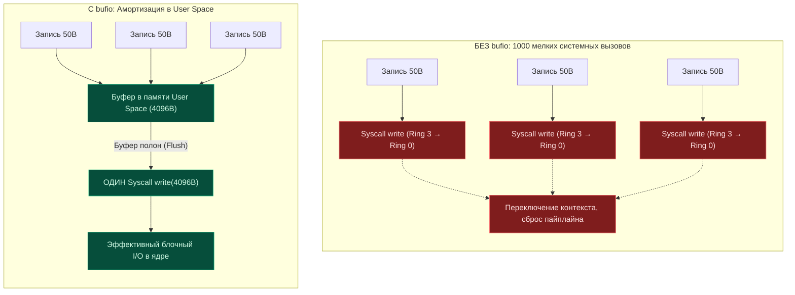
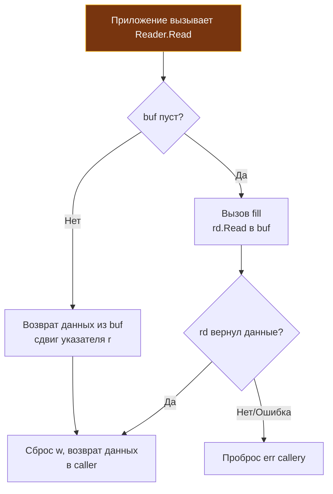

## Философия буферизации: мост между User Space и Kernel Space

> *«Буфер в пользовательском пространстве подобен почтовой сумке: вы же не гоняете курьера через весь город ради каждого отдельного письма — вы наполняете сумку и отправляетесь в путь один раз».*    
> — Инженерная аналогия Bell Labs

Представьте курьерскую службу, которой нужно доставить тысячу писем. Если курьер будет садиться на мотоцикл, заводить мотор, стоять в городских пробках, отмечаться на пропускном пункте и передавать ровно одно письмо, а затем возвращаться обратно за следующим — такая служба обанкротится в первый же день. Любой здравомыслящий человек сложит все письма в почтовую сумку и доставит их за один рейс.

В операционных системах этот дорогостоящий вояж курьера называется **системным вызовом (syscall)**. Пакет `bufio` решает фундаментальную проблему производительности, заложенную в архитектуре современных ОС. Каждый вызов `read()` или `write()` требует аппаратного переключения контекста Ring 3 → Ring 0, сохранения регистров центрального процессора в стек ядра, валидации прав доступа, прохода через виртуальную файловую систему (VFS) и обратного переключения Ring 0 → Ring 3. 

Если ваше сетевое приложение или микросервис отправляет данные в сокет или пишет в лог-файл по 50 байт на операцию, большая часть времени уходит на переход в ядро и обратно и сброс конвейера CPU, а не на полезную работу.

`bufio` создаёт промежуточный амортизационный слой прямо в пространстве пользователя (User Space). Вместо прямого обращения к ядру данные сначала накапливаются в обычном срезе `[]byte` оперативной памяти процесса. Системный вызов происходит только тогда, когда буфер заполнен до краев или когда разработчик явно требует немедленного сброса данных во внешний мир.



> [!info] Под капотом
> `bufio` не является магией. Это тонкая обёртка над обычным массивом байтов и счётчиками позиций. Его главная задача — **амортизировать стоимость syscall**, превращая тысячи мелких операций в несколько крупных. Это классический пример Mechanical Sympathy: мы выравниваем паттерн доступа приложения под оптимальный размер страницы памяти и MTU сетевого стека.

---

## Under the hood: Внутреннее устройство Reader и Writer

Внутри структуры `bufio.Reader` и `bufio.Writer` выглядят предельно просто и лаконично, но их состояние управляется строгим контрактом:

```go
// Упрощённое представление bufio.Writer
type Writer struct {
    err error          // Первая возникшая ошибка
    buf []byte         // Внутренний буфер (по умолчанию 4096 байт)
    n   int            // Количество данных в buf, готовых к flush
    wr  io.Writer      // Обёрнутый писатель
}

// Упрощённое представление bufio.Reader
type Reader struct {
    buf       []byte
    rd        io.Reader // Обёрнутый читатель
    r         int       // Позиция чтения в buf
    w         int       // Позиция записи в buf (сколько прочитано из rd)
    err       error
}
```

```
Схема буфера Reader в оперативной памяти:
+-------------------------------------------------------------+
|    Уже прочитано    | Доступно для чтения |    Свободно     |
+-------------------------------------------------------------+
0                     ▲                     ▲                 len(buf)
                      │                     │
                      r (read index)        w (write index)
```

### Алгоритм работы `Writer.Write()`:
1. Если буфер пуст, а `p` не меньше его размера, данные идут напрямую в нижележащий writer, минуя буфер. Если места в `buf` достаточно, данные копируются в срез через быструю инструкцию ассемблера `copy()`, счётчик `n` увеличивается. Системный вызов ядра не происходит.
2. Если места недостаточно, метод `Flush()` вызывает `wr.Write(buf[:n])`, отправляя накопленные данные в ядро.
3. Если новые данные всё ещё не помещаются в очищенный буфер (их размер больше размера самого буфера), они пишутся напрямую в `wr`, минуя буферизацию (fallback).

### Алгоритм `Reader.Read()`:
1. Возвращает данные из `buf` начиная с позиции `r`.
2. Если буфер пуст (`r == w`) и `p` не меньше размера буфера, чтение идёт напрямую в `p`, минуя буфер. Иначе делается один крупный `rd.Read(buf)` (не цикл `fill`).
3. Позиции `r` и `w` сдвигаются, избегая лишнего копирования данных через системный `memmove` до тех пор, пока буфер полностью не освободится.



---

## Mechanical Sympathy: Кэш-линии и давление на GC

Буферизация напрямую влияет на архитектуру процессора и работу сборщика мусора:

1. **Локальность ссылок (Spatial Locality)**: Последовательное чтение/запись внутри одного среза `buf` гарантирует, что данные загружаются в кэш-линии L1/L2 предсказуемо. CPU hardware prefetcher эффективно подгружает следующие 64 байта, устраняя `cache miss`.
2. **Escape Analysis и аллокации**: По умолчанию `bufio.NewReader()` и `NewWriter()` выделяют внутренний буфер в куче. Если функция, создающая reader/writer, возвращает их наружу, компилятор не может разместить буфер на стеке. В высоконагруженных сервисах это создаёт фоновый поток аллокаций.

> [!warning] Ловушка / Gotcha
> **Ручное управление размером буфера.**
> По умолчанию буфер — 4096 байт. Для крупных потоков (файлы, сеть с большими ответами) буфер 32–64 КБ уменьшает число системных вызовов. Вы можете передать свой размер в конструктор:
> `bufio.NewReaderSize(conn, 32*1024)`. Это позволяет контролировать число системных вызовов и давление на GC. Размер буфера фиксирован на всё время жизни Reader/Writer.

---

## Практика и идиомы работы с пакетом

### 1. Правильная работа с Writer и Flush
Никогда не полагайтесь на `defer` для закрытия, если вам важен результат записи. Метод `Flush()` сбрасывает данные в underlying writer и может вернуть ошибку:

```go
func writeLogBatch(w io.Writer, lines []string) error {
    bw := bufio.NewWriter(w)
    
    for _, line := range lines {
        if _, err := bw.WriteString(line); err != nil {
            // Ошибка bufio.Writer «липкая»: все последующие Write и Flush вернут её же,
            // поэтому повторный Flush её не исправит. Возвращаем ошибку сразу.
            return fmt.Errorf("write to buffer failed: %w", err)
        }
    }
    
    // Критично: явный Flush с проверкой ошибки
    if err := bw.Flush(); err != nil {
        return fmt.Errorf("flush failed: %w", err)
    }
    return nil
}
```

### 2. Scanner: парсинг по токенам
`bufio.Scanner` абстрагирует чтение по строкам или словам. По умолчанию он использует ограничение длины токена в 64 КБ (`bufio.MaxScanTokenSize`). При превышении лимита сканирование завершается (`Scan()` возвращает `false`), а `scanner.Err()` возвращает ошибку `bufio.ErrTooLong` (паники не происходит).

```go
func processLines(r io.Reader) error {
    scanner := bufio.NewScanner(r)
    scanner.Buffer(make([]byte, 0, 64*1024), 1024*1024) // Увеличиваем макс буфер до 1 МБ
    scanner.Split(bufio.ScanLines)
    
    for scanner.Scan() {
        line := scanner.Bytes() // Возвращает ссылку на внутренний буфер!
        process(line)
    }
    return scanner.Err()
}
```

> [!warning] Ловушка / Gotcha
> `scanner.Bytes()` возвращает **срез внутреннего буфера сканера**, который будет перезаписан при следующем вызове `Scan()`. Если вам нужно сохранить данные за пределами цикла, обязательно делайте копию: `data := bytes.Clone(scanner.Bytes())` (Go 1.20+) или `append([]byte(nil), scanner.Bytes()...)`. `scanner.Text()` уже возвращает новую строку-копию (это аллокация на каждую строку).

### 3. Peek и ReadBytes
`Peek(n)` возвращает ссылку на следующие `n` байт без сдвига указателя чтения. Это полезно для заглядывания в заголовок протокола. Но если вы не прочитаете эти байты явно после `Peek`, они останутся в буфере и будут возвращены при следующем `Read()`.

---

## Ловушки и вопросы с собеседований

| Сценарий | Проблема | Решение |
|----------|----------|---------|
| Смешивание API | Вызов `conn.Read()` напрямую после создания `bufio.NewReader(conn)` | Данные в буфере будут потеряны. Используйте **либо** `bufio`, **либо** прямой `io`, никогда одновременно. |
| Частичная запись | `Writer.Write()` вернул ошибку | После ошибки `bufio.Writer` запоминает её: все последующие `Write` и `Flush` возвращают ту же ошибку и ничего не пишут. Несброшенные данные в буфере потеряны для этого writer. Обработайте ошибку (повтор операции целиком, другой приёмник) и при повторном использовании вызовите `Reset(w)`. |
| Ошибка токена (ErrTooLong) | `bufio.Scanner: token too long` (`Scan()` вернет `false`) | Увеличьте лимит через `scanner.Buffer(buf, max)`. `ReadBytes('\n')` ограничения не имеет: для недоверенного ввода ставьте `io.LimitReader` под `bufio.Reader` или читайте `ReadSlice`/`ReadLine` с обработкой `ErrBufferFull`. |
| `ReadString` vs `ReadLine` | `ReadLine` возвращает флаг `isPrefix` для длинных строк и обрезает `\n` | `ReadString` или `ReadBytes` для сетевого ввода — только с ограничением длины (они накапливают фрагмент до разделителя без предела). Они возвращают полный фрагмент до разделителя включительно. |

> [!tip] Собеседование
> **Вопрос:** Почему `bufio.Scanner` не поддерживает чтение больших бинарных файлов эффективно?  
> **Ответ:** `Scanner` удобен, когда поток делится на токены: строки, слова, руны или ваш формат через `SplitFunc`. Для больших сплошных двоичных данных он не нужен: используйте `io.Copy` или `bufio.Reader`. Токен ограничен размером буфера (по умолчанию 64 КБ), а `Text()` копирует каждую строку.
>
> **Вопрос:** Как переиспользовать `bufio.Writer` в горячем HTTP-обработчике?  
> **Ответ:** Возьмите `*bufio.Writer` из `sync.Pool`, вызовите `bw.Reset(w)`, а перед возвратом в пул — `bw.Flush()` (`Reset` выбрасывает несброшенные данные). Без `Reset` writer продолжит писать в ответ предыдущего запроса. Помните и про то, что `bufio` **не потокобезопасен**.

---

## Сравнение с другими языками

| Язык | Механизм | Особенности в сравнении с Go |
|------|----------|------------------------------|
| **Java** | `BufferedInputStream`, `BufferedReader` | Работает по схожему принципу, но является частью иерархии `InputStream`. Требует явного вызова `close()` для сброса. В Go `Close()` не вызывает `Flush()` автоматически (в `bufio` нет `Close` у writer, только у обёрнутого `io.Closer`). |
| **C++** | `std::filebuf`, `std::streambuf` | Буферизация встроена в сам поток. Управление буфером происходит через `pubsetbuf()`. В Go буфер вынесен в отдельный пакет, что упрощает композицию (`bufio.NewWriter(os.Stdout)`). |
| **PHP** | `stream_set_chunk_size()`, обёртки над `fopen` | Буферизация часто управляется на уровне веб-сервера (Nginx/Apache) или через `output buffering`. В Go контроль полностью на уровне приложения, что даёт предсказуемость и отсутствие скрытых задержек отладки. |

---

## Итог

1. `bufio` — это амортизатор стоимости системных вызовов. Превращает множество мелких `read/write` в несколько крупных.
2. Всегда вызывайте `Flush()` явно и проверяйте возвращаемую ошибку. `defer` для закрытия файла не сбрасывает буфер писателя.
3. `bufio.Scanner` удобен для строк, но имеет лимит в 64 КБ по умолчанию, а `Bytes()` возвращает ссылку на внутренний буфер (`Text()` — копию). Копируйте данные при необходимости.
4. Никогда не смешивайте буферизированный и небуферизированный API на одном и том же дескрипторе. Это приведёт к потере данных.
5. Пакет не потокобезопасен. При конкурентной записи используйте `sync.Mutex` или создавайте отдельные экземпляры на каждый поток выполнения.
6. `os.Stdout` в Go не буферизован: при выводе многих мелких строк оберните его в `bufio.NewWriter` и не забудьте `Flush`.

Освоив эффективную работу с байтовыми потоками, мы переходим к одной из самых частых задач в Go: манипуляции текстовыми данными. В следующей статье разберём оптимизацию, аллокации и скрытые затраты при работе со строками: [[7. strings. Работа со строками]].